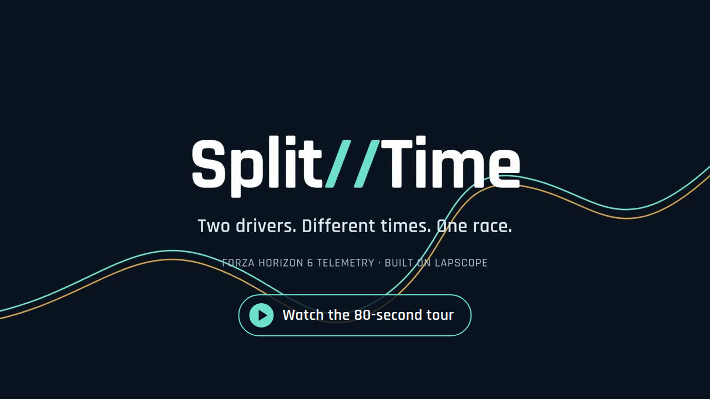
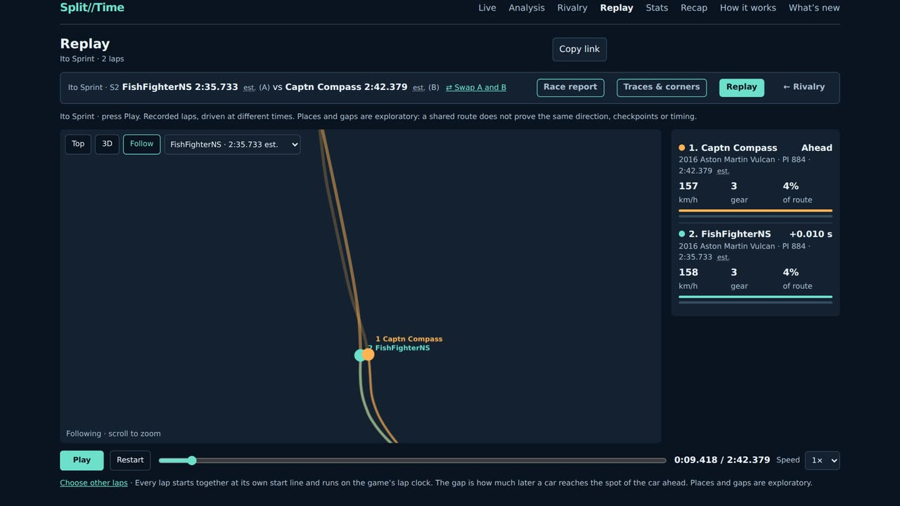
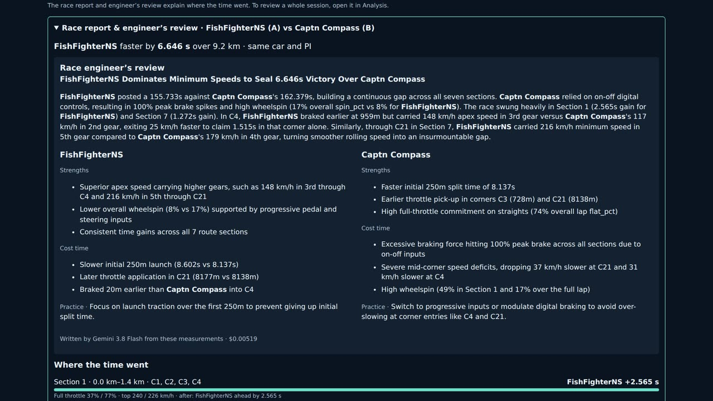
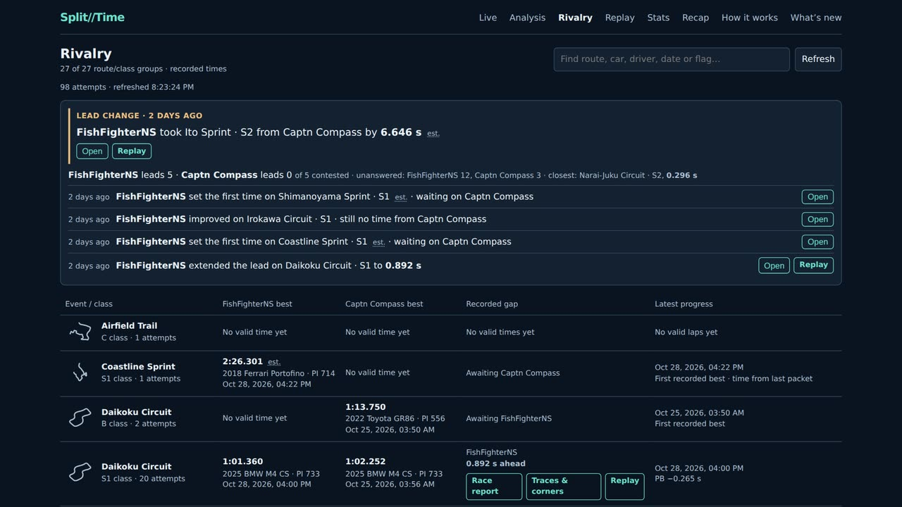
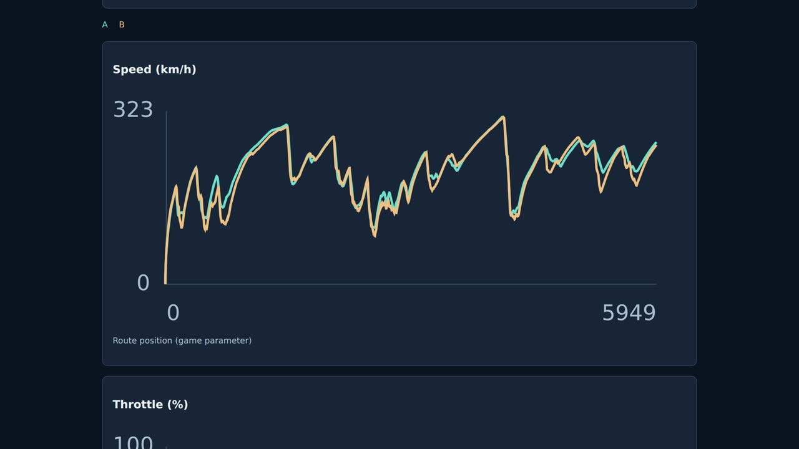
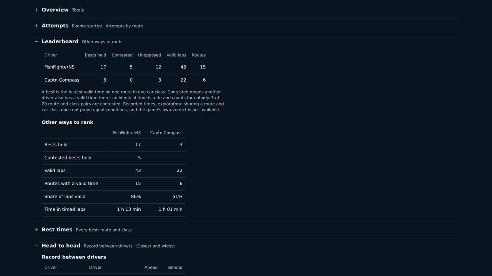
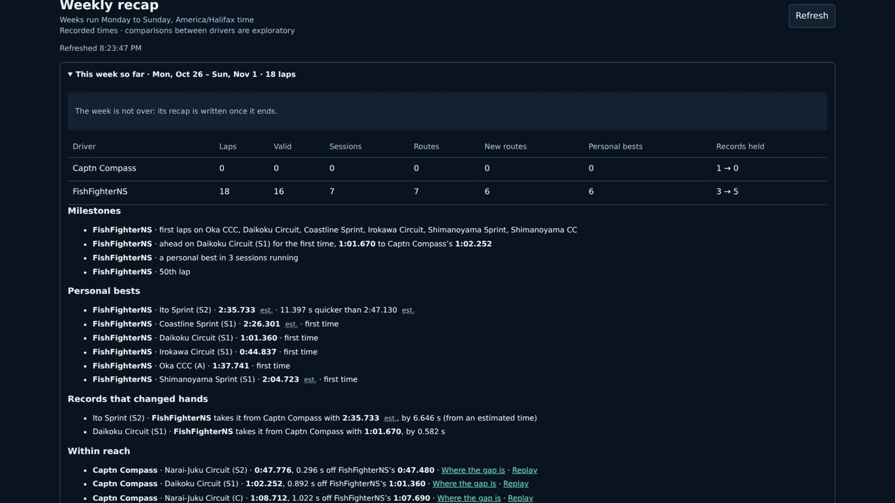

# SplitTime

Self-hosted Forza Horizon 6 telemetry for two drivers who play at different
times. Each driver's game streams Data Out UDP to the server. The site records
every event automatically, and both drivers compare laps afterwards, as if
they had raced each other.

[](https://test.hensler.work/splittime-reel/)

*[Watch the tour](https://test.hensler.work/splittime-reel/), or
[download it](https://github.com/adrianhensler/splittime/releases/download/reel-2026-10-30/splittime-reel.mp4)
(MP4, 16 MB). Recorded from the two drivers' real data; the Live scene is a
simulated drive.*

| | |
|---|---|
| [](docs/media/replay.jpg) | [](docs/media/race-engineer.jpg) |
| **Replay**: two recorded laps raced head to head, following one car | **Race report**: the AI race engineer's review, every number checked against the telemetry |
| [](docs/media/rivalry.jpg) | [](docs/media/traces.jpg) |
| **Rivalry**: records per route and class, and the latest lead changes | **Traces & corners**: speed, throttle, brake and steering by distance |
| [](docs/media/stats.jpg) | [](docs/media/recap.jpg) |
| **Stats**: leaderboards, head to head and more | **Weekly recap**: milestones, personal bests and records within reach |

SplitTime is built on [LapScope](https://github.com/darcane/LapScope) by
Erdem Darcan, which supplies the recorder, lap and event detection, storage
and the original analysis page. Its corner detection thresholds are adapted
from [Forza-6-telemetry](https://github.com/ClickClickMedia/Forza-6-telemetry)
by ClickClickMedia. Both are MIT-licensed; see [Credits](#credits).

**Status:** in regular use by its two drivers on one server. It is a hobby
project: comparisons between drivers are exploratory, not official results,
and the in-app How it works page (`app/static/how-it-works.html`) lists what
the recorder can get wrong.

## What it does

- **Live**: a card per driver while they drive (speed, gear, inputs, map),
  from an always-on collector that keeps recording while the website updates.
- **Analysis**: up to six laps overlaid, across sessions and drivers: speed,
  throttle, brake and steering along the lap.
- **Rivalry**: records per route and car class, who holds what, every
  attempt (finished or given up) and the latest lead changes.
- **Race report**: two laps compared section by section and corner by corner
  (corners numbered per route), with an optional AI race engineer's review.
  The AI only writes about measured facts, and every number it states is
  checked against them; a review that fails the check is not shown. When
  SplitTime runs as a separate recorder and website, a report is also
  written by itself whenever a record changes hands.
- **Then vs now**: a driver's current best against their first clean run on
  the same route.
- **Replay**: recorded laps raced against each other on the map, from above
  or following one car.
- **Stats**: totals, leaderboards, head to head, clean driving, consistency,
  improvement, routes, cars, activity, achievements and next goals.
- **Weekly recap**: each Monday-to-Sunday week's laps, personal bests,
  records that changed hands, the records each driver is closest to taking
  back, and dated milestones (new routes, lap counts, personal-best streaks,
  first time ahead), with an optional fact-checked AI column.
- **Session debrief**: a measured review of a whole session.
- **Refresh offer**: open pages say when new results arrive; nothing reloads
  by itself.
- **How it works** and **What's new** pages in the app itself.

Lap times keep their provenance: a time SplitTime had to take from its own
clock, because the game stopped sending at the finish line, is marked "est."
wherever it appears.

The AI features are optional (an OpenRouter key on the server) and share one
hard budget of $1 per UTC month. Everything else works without them.

## Getting started

### How it fits together

```
 Driver A's game ──UDP 9999───┐
                              ├──▶ SplitTime server ──▶ web pages (anyone can view)
 Driver B's game ──UDP 10000──┘          ▲
                                         └── your login gateway (needed to edit)
```

- **Drivers aren't accounts.** Each driver has a UDP port on the server. The
  game sends telemetry to that port, and that port is how SplitTime knows
  whose lap it is. Drivers never sign in, and no gamertag is sent.
- **Viewing is open.** Whoever can reach the site can see every page.
- **Editing needs a login, and SplitTime doesn't have one.** Renaming or
  deleting a session, regrouping laps or asking the AI for a review all
  change data or spend money, so they must go through a web server or
  gateway that asks for a password (nginx or Caddy basic auth is enough).
  "Users" are whoever that gateway lets in.

**Do you need a login at all?** Not for SplitTime to work. With no login,
every lap is still recorded, every page works, and any automatic AI reports
(see Settings) are still written by the server. The login only protects
the edits above: without one, anyone who can reach the site can make them,
including deleting recordings (AI spend stays within its $1 a month cap). So:

- **Only you and your drivers can reach it** (home network, VPN, or just your
  own computer): no login needed. SplitTime refuses requests that arrive
  under hostnames it doesn't know, so a web page can't reach it by pointing
  its own domain at your machine.
- **It's on the internet:** put a login in front of everything except GET and
  HEAD, so anyone can view but only people you allow can edit. The reference
  deployment does this with its site's existing sign-in, limited to an
  allowlist of accounts ([docs/hosting/](docs/hosting/)).

### Try it on your own machine (no game needed)

Python 3.12. Two terminals, from the repository folder:

```sh
python -m venv .venv && . .venv/bin/activate
pip install -r requirements.txt
export SPLITTIME_DRIVERS='[{"id":"alex","name":"Alex","udp_port":19999},{"id":"sam","name":"Sam","udp_port":20000}]'
export DATA_DIR=/tmp/splittime-tryout
uvicorn app.main:app --port 8100
```

```sh
. .venv/bin/activate
python tools/simulator.py --port 19999    # drives as Alex for about 2.5 minutes
```

About 15 seconds after the simulator finishes, open <http://localhost:8100/>.
Alex now has a session with three laps. Run it again with `--port 20000` to
give Sam a lap to compare against.

The try-out uses spare ports and its own data folder, so it can't touch a
real installation on the same machine. A real one uses ports 8000, 9999 and
10000 and keeps its recordings in `./data`, as below.

### Run it for real

You need a Linux server with a fixed public IPv4 address. The game takes an
IP address, not a hostname. [docs/SETUP.md](docs/SETUP.md) has the details;
in short:

1. **Set the drivers and settings** in a `.env` file next to
   `docker-compose.yml`, one per line, for example:

   ```sh
   SPLITTIME_DRIVERS=[{"id":"alex","name":"Alex","udp_port":9999},{"id":"sam","name":"Sam","udp_port":10000}]
   LS_ALLOWED_HOSTS=splittime.example.com
   ```

   Keep `.env` out of Git if it holds an API key.
2. **Open the UDP ports** in the server's firewall and in your hosting
   provider's firewall, if it has one. A tunnel or CDN such as Cloudflare
   does not carry game traffic: the game must reach the server's own address.
3. **Start it:** `docker compose up -d --build`. The web side listens on
   `127.0.0.1:8000` only.
4. **Put a gateway in front** that serves HTTPS, proxies to port 8000, and
   asks for a login on everything except GET and HEAD (or on everything, if
   the site should be private). SplitTime refuses requests for hostnames it
   doesn't know, hence `LS_ALLOWED_HOSTS` above.
5. **Send each driver** [docs/GAME_SETUP.md](docs/GAME_SETUP.md) with the
   server's IP address and their port. It is five steps in the game's
   settings, done once.

### Adding, renaming or removing a driver

Drivers are set only by `SPLITTIME_DRIVERS`, read when SplitTime starts.
Each entry has three fields:

| Field | What it is |
|---|---|
| `id` | Permanent storage name: letters, digits, `_` or `-`. Never change it, or the driver starts over with no history. |
| `name` | What the pages show. Change it whenever you like. |
| `udp_port` | Where that driver's game sends. 1025 or higher, never 5200–5300 (the game uses those). Each driver needs their own. |

- **Add a driver:** add an entry with a new `id` and port, open the port in
  the firewall(s), publish it in `docker-compose.yml`
  (`- "10001:10001/udp"`), restart, and send them the game setup page.
  SplitTime takes up to 8 drivers, but it was built for two: comparisons and
  the AI reviews put two drivers side by side.
- **Rename:** change `name` and restart. Old laps show the new name.
- **Remove:** delete the entry and restart. Their recordings stay; nothing
  new is recorded for them.

Restart only when nobody is driving, or the event in progress is lost.
[docs/SETUP.md](docs/SETUP.md#optional-collector-and-web-as-two-processes)
shows how to split SplitTime into a recorder that keeps running and a website
you can restart at any time.

### Settings

All optional except `SPLITTIME_DRIVERS`.

| Setting | Default | What it does |
|---|---|---|
| `SPLITTIME_DRIVERS` | one driver on port 9999 | The drivers, as above |
| `LS_ALLOWED_HOSTS` | localhost and IP addresses | Extra hostnames the site answers to, comma-separated |
| `OPENROUTER_API_KEY` | none | Turns on the AI reviews and weekly column. Capped at $1 per month in total. |
| `SPLITTIME_AUTO_RACE_REPORTS`, `SPLITTIME_AUTO_RECAPS` | `1` | Automatic race reports and weekly columns. These only run when SplitTime is split into a recorder and a website ([docs/SETUP.md](docs/SETUP.md#optional-collector-and-web-as-two-processes)); in the single process above, use the buttons. Set to `0` to turn them off. |
| `RECAP_TZ` | `America/Halifax` | Time zone the weekly recap's Monday-to-Sunday weeks follow |
| `DATA_DIR` | `./data` | Where recordings are kept. Back it up. |
| `LS_OFFLINE` | `0` | `1` stops the once-a-day car and route list updates from LapScope's GitHub |

### Development

There's no build step: the pages are plain HTML and JavaScript served by
the Python app.

```sh
pip install -r requirements.txt -r requirements-dev.txt
python -m pytest -q                 # backend
node --test tests/ui/*.test.cjs     # page scripts
```

Read [AGENTS.md](AGENTS.md) before changing anything; it applies to people as
well as coding agents.

## Documents

| Doc | What it is |
|---|---|
| [docs/DESIGN.md](docs/DESIGN.md) | The spec: scope, architecture, data model, behaviour rules, acceptance checks |
| [docs/DATA_FLOW.md](docs/DATA_FLOW.md) | What is sent, by whom, to where, and what is kept |
| [docs/GAME_SETUP.md](docs/GAME_SETUP.md) | One-page setup for each driver |
| [docs/SETUP.md](docs/SETUP.md) | Running a server: accounts, firewall, reverse proxy, pitfalls |
| [docs/hosting/](docs/hosting/) | The owner's own deployment, as a worked example. Not part of the software. |
| [docs/UPSTREAM.md](docs/UPSTREAM.md) | The two MIT projects this builds on, what was taken, and licence duties |
| [docs/ADR.md](docs/ADR.md) | Decision record |
| [docs/BUILD_PLAN.md](docs/BUILD_PLAN.md) | Milestones, risks, deferred items, open questions |
| [docs/WORKPACKETS.md](docs/WORKPACKETS.md) | How work is assigned, recorded, verified and accepted |
| [work/](work/) | One Workpacket per milestone, with its evidence |
| [AGENTS.md](AGENTS.md) | Rules for any coding agent or person working here |
| [docs/WORKPACKET_TAKEAWAYS.md](docs/WORKPACKET_TAKEAWAYS.md) | Notes for the separate Workpacket project |
| [docs/REVIEW_HANDOFF_2026-10-12.md](docs/REVIEW_HANDOFF_2026-10-12.md) | Independent design review, corrections and coding-agent handoff |
| [docs/upstream/](docs/upstream/) | LapScope's own documents, unchanged. Read `ARCHITECTURE.md` and `wiki/Event-Detection.md` before touching the recorder. |
| [THIRD_PARTY_NOTICES.md](THIRD_PARTY_NOTICES.md) | Licences of the code this includes |
| [docs/archive/](docs/archive/) | Original concept PDF (superseded by DESIGN.md) |

## Credits

- **[LapScope](https://github.com/darcane/LapScope)** by Erdem Darcan (MIT):
  the base of this repository, imported whole at `c39a8d9`: packet parsing,
  the UDP listener, session, lap, finish, rewind and contact detection,
  storage, reprocessing, the route catalogue, car names, the analysis page,
  the simulator and its tests.
- **[Forza-6-telemetry](https://github.com/ClickClickMedia/Forza-6-telemetry)**
  by ClickClickMedia (MIT): the corner detection approach and thresholds
  (lateral g, heading change, and the hairpin, switchback and sweeper rules),
  adapted in `app/corners/detect.py`.

Their licences are reproduced in [THIRD_PARTY_NOTICES.md](THIRD_PARTY_NOTICES.md),
and [docs/UPSTREAM.md](docs/UPSTREAM.md) records exactly what was taken.
Forza Horizon is a trademark of Microsoft; SplitTime is not affiliated with
Microsoft or Playground Games.

## Licence

SplitTime's own code is under the [MIT licence](LICENSE). The code it
includes from the projects above stays under their MIT licences and
copyright notices.
