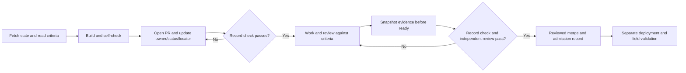

# How work is done here: Workpackets

SplitTime uses a light, git-native form of the owner's Workpacket method
(`adrianhensler/workpacket`). It works with any coding agent, or a person,
because everything needed is in plain files in this repo. This is
**Workpacket-light**, not a second software product or a mandatory gate after
every small coding step.

A **Workpacket** is the durable record of one bounded piece of work: what was
wanted, what the worker was allowed to do, what they claim, the evidence, what
is still unknown, and whether it was verified and accepted. The packet is the
handoff. A new worker should be able to continue from the packet alone, without
the previous worker's conversation.

## When a packet is needed

| Work | Packet? |
|---|---|
| A milestone, or any task spanning sessions or workers | Yes |
| Anything whose result someone else must trust without redoing it | Yes |
| A typo, a one-line fix, answering a question | No. Just do it and commit. |

## Where and what

Packets are markdown files in [`work/`](../work/), one per file, named
`WP-NNN-short-name.md`. Start from [`work/TEMPLATE.md`](../work/TEMPLATE.md).
Git provides versioned content and a useful edit trail, so this private POC
needs no extra signatures or digest machinery. **Git author metadata is not
proof of identity or authority; a commit or hash is not evidence that claims
are true or that tests actually passed.** Record reproducible checks separately.

## One record, not two

While a pull request is open, **its description is the packet's live record**:
claims, commands and results, what was not tested, known limits. Reviewers read
pull requests, not `work/` files, and keeping the same tables in both places
doubled the writing on WP-001 and WP-005 for no benefit.

The packet file holds what the pull request cannot: intent, authority and
limits, and acceptance criteria, all written before the work. While the pull
request is open, the packet's Claims and Evidence sections say only
"see PR #N"; do not keep the same tables up to date in both places.

**When the pull request is ready to merge, write the record into the packet
once**, in the same pull request: the final claims with their basis, the
commands that re-run the evidence, what is unknown or asserted, the head
commit, and what the reviewer did and did not check. After the merge the
packet must stand without the pull request, because the repository is the
handoff and a pull request may not be readable by the next worker.

Status that changes hour to hour (who is on what, what is in review) lives in
the pull request list. What has merged is in `git log` and the merged pull
request list; no document keeps a copy (ADR 21).

## Fixed triggers, ownership and the check

The default branch/code/test/PR loop did not maintain packets in this build.
Rules alone also failed at integration. These are explicit steps in that
loop, with the worker responsible for the packet and the integrator responsible
for the combined record. Name one checkpoint owner in `Worker`; preserve
original contributors separately. A reviewer checks the packet too.

1. **PR opens:** put `Workpackets: WP-002, WP-004` (the actual scope) on its
   own line in the PR body. Update those packets' status, owner, PR locator
   and checkpoint. Claims/Evidence locate the live PR. If stopping part-way,
   leave the next reproducible action and unresolved criteria in the checkpoint.
   A trivial change that needs no packet may instead declare
   `Workpackets: none — <reason>` on one line. The reason is required and the
   reviewer judges whether the exemption fits; do not mix it with packet IDs.
2. **PR becomes ready:** snapshot final claims with their basis, re-runnable
   commands, unknowns, reviewer coverage and pending admission into the packet.
   Partial criteria stay partial. Review the snapshot with the code; a passing
   packet check cannot approve either. The reviewer merges (ADR 21); the merge
   is the admission record. Deployment remains a separate fact.

`scripts/check_workpackets.py` runs as the `records` job in CI when a pull
request opens, is pushed to, or is marked ready. Product changes
need declared packets; isolated modules have mapped scope; shared files rely
on the declared scope and reviewer judgment. Declared/mapped packets must be
touched in the PR, have a worker, and no draft/not-started checkpoint. Ready
PRs also require nonempty final Claims/Evidence rows and explicit uncertainty,
verification and acceptance sections. `tests/test_workpacket_guard.py` attempts
the stale-record failures observed here and several omissions.

This is a structural drift check. It cannot prove evidence truth, detect every
stale factual sentence or infer the correct milestone for a shared file.
Marking a partial packet ready for integration does not complete its original
criteria. **The check is advisory** (owner's decision, ADR 21): it runs as the
`records` job in CI, shows red when it finds drift, and never blocks a merge.
An independent test on 2026-10-12 got 25 of 26 stale or wrong records past
it. Trivial changes now have the explicit exemption above, so it is a prompt
for the reviewer and not a gate.

## Three roles, kept apart

| Role | Does | May be |
|---|---|---|
| **Worker** | The work. Records claims, evidence, unknowns and a checkpoint. | Any agent or person |
| **Verifier** | Checks the claims against the acceptance criteria. | A different session, agent or person from the worker |
| **Acceptor** | Decides the result is accepted. | The owner only |

Workers may run tests and report them as **self-checks**, but cannot describe
those checks as independent verification or owner acceptance. If no independent
verifier was available, record that explicitly. Independent review is most
valuable before accepting or deploying consequential results; it is not a
mandatory pause before the next authorized POC implementation step.

## States

`draft` → `in-progress` → `complete` → `admitted`

- **draft**: outcome, authority and acceptance criteria are being defined.
- **in-progress**: a worker has it.
- **complete**: the worker declares it finished. Claims and evidence are
  filled in. Not yet accepted.
- **admitted**: the owner accepted it. Later work may rely on it.
  **In this project a merge to `main` counts as admission** (owner's decision,
  2026-10-12, ADR 20). The pull request must have been reviewed by someone
  other than its author, and that reviewer merges it once nothing blocking
  remains and CI is green (ADR 21). Docs-only pull requests are the
  exception and admit nothing by merging. Admission covers
  what the pull request states and no more: anything it lists as untested,
  unknown or asserted stays that way. Deployment and anything needing root
  still need the owner's explicit say.
- **parked**: waiting on something outside the worker's authority. Says what.
- **failed**: could not be done as specified. Says why and what was learned.

## Rules

1. **Claims need a basis.** Every claim points to evidence, or is marked
   `asserted`. Prefer evidence that can be re-run (a command, a test, a commit)
   over pasted output.
2. **Say what is missing.** Known, unknown and unproven are listed separately.
   Never turn unresolved work into success by leaving it out.
3. **Always leave a checkpoint.** Before stopping for any reason, write the
   next action and anything a replacement worker needs.
4. **Stay inside the authority.** If the packet does not grant it, do not do
   it. Record the need and park or ask.
5. **Reversible defaults may be assumed and recorded.** Mark them unproven
   and easy to reverse. Never assume away missing authority, security gates,
   evidence, or acceptance criteria.
6. **Children do not prove the parent.** A packet split into child packets is
   still verified as a whole.
7. **Decisions go to the ADR, not the packet.** Mark who decided: the owner
   (Accepted) or a worker's default (Proposed).
8. **Keep it small.** A packet that takes longer to write than the work it
   records should not exist.
9. **Fetch before you write.** Another worker may have pushed coordination
   documents, issues or a branch for you since you last looked. Check the
   remote, the issue list and the pull request list before starting a packet
   or writing anything about who does what.
10. **Agree the interface before building on it.** When two workers' parts
    meet, write the contract and have the other side review it first. It is
    the cheapest review there is.
11. **State unknowns in the data too.** If a result rests on something
    unverified, the output should carry that (`null`, a `*_verified: false`
    flag, a `comparable: false` with a reason), not only the packet.

## Working a packet

1. Read `AGENTS.md`, then the packet, then only the context it references.
2. Set status `in-progress` and name yourself as worker. Check the remote first (rule 9).
3. Do the work within authority and limits. Commit as you go.
4. Keep claims, evidence and limits in the pull request description while it
   is open. Keep the packet's checkpoint current if you stop part-way.
   Before merge, write the final record into the packet once (see "One
   record, not two").
5. Set status `complete` with explicit limitations. Continue into another
   *authorized* slice if useful; do not label it independently verified or
   owner-accepted. Keep checkpoints small and actionable.
